<div align="center">

<picture><source media="(prefers-color-scheme: dark)" srcset="assets/bento/banner-dark.svg"><source media="(prefers-color-scheme: light)" srcset="assets/bento/banner-light.svg">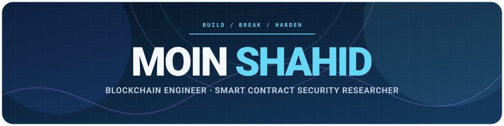</picture>

</div>

<div align="center">

[](https://linkedin.com/in/moin-shahid)
[](mailto:moinshahid919@gmail.com)
[](https://github.com/moeenali01)

[](#about)
[](#security-research)
[](#experience)
[](#selected-engineering-work)
[](#technical-toolkit)
[](#education--continuous-learning)
[](mailto:moinshahid919@gmail.com)

</div>

<br/>

<picture><source media="(prefers-color-scheme: dark)" srcset="assets/bento/section-01-dark.svg"><source media="(prefers-color-scheme: light)" srcset="assets/bento/section-01-light.svg"></picture>

## About

### I build with the failure modes in mind.

I am a **Blockchain Engineer**, working across **EVM and Solana**. I build DeFi and smart contract systems, then examine the assumptions that can fail under adversarial use: accounting, permissions, oracle inputs, and upgrade paths.

At **Webevis Technologies**, I develop Solidity contracts and Foundry test suites for EVM deployments. My Solana work uses **Rust, Anchor, and Bankrun**. I aim for systems whose state transitions are clear, whose privileged actions are narrow, and whose important behaviors are covered by reproducible tests.

**How I work**

- **Design:** define invariants, value flows, and trust boundaries before implementation.
- **Verify:** test normal flows, edge cases, and adversarial interactions with unit, fuzz, and invariant tests.
- **Harden:** apply least-privilege access, careful validation, reentrancy protection, and gas-conscious architecture.

<details>
<summary><b>View my profile as Solidity and Rust</b></summary>

<br/>

<p></p>

```solidity
// SPDX-License-Identifier: MIT
pragma solidity ^0.8.20;

/// @title whoami
/// @author Moin Shahid
contract MoinShahid {
    string public constant NAME = "Moin Shahid";
    string public constant ROLE = "Blockchain Engineer";
    string public constant FOCUS = "Smart contract security";
    string public constant COMPANY = "Webevis Technologies";
    string public constant BASED_IN = "Lahore, Pakistan";
    string public constant DEGREE = "BS Information Technology";
    string public constant MOTTO = "Build. Break. Harden.";

    function chains() external pure returns (string[2] memory) {
        return ["EVM", "Solana"];
    }

    function languages() external pure returns (string[3] memory) {
        return ["Solidity", "Rust", "JavaScript"];
    }

    function contact() external pure returns (string memory) {
        return "moinshahid919@gmail.com";
    }
}
```

<p></p>

```rust
use anchor_lang::prelude::*;

declare_id!("Fg6PaFpoGXkYsidMpWTK6W2BeZ7FEfcYkg476zPFsLnS");

#[program]
pub mod profile {
    use super::*;

    pub fn status(_ctx: Context<Show>) -> Result<()> {
        msg!("Now: Webevis Technologies");
        msg!("Chains: EVM + Solana");
        msg!("Findings: 3 High, 2 Medium, 1 Low");
        Ok(())
    }

    pub fn core_stack(_ctx: Context<Show>) -> Result<()> {
        msg!("EVM: Solidity, Foundry");
        msg!("Solana: Rust, Anchor, Bankrun");
        msg!("Oracles: Chainlink, Pyth, TWAP");
        Ok(())
    }
}

#[derive(Accounts)]
pub struct Show {}
```

<sub>Yes, it compiles. &nbsp;<code>solc 0.8.30</code> · zero warnings &nbsp;·&nbsp; <code>anchor&#8209;lang 1.2.2</code> · clippy clean.</sub>

</details>

<picture><source media="(prefers-color-scheme: dark)" srcset="assets/bento/section-02-dark.svg"><source media="(prefers-color-scheme: light)" srcset="assets/bento/section-02-light.svg"></picture>

## Security Research

My research focuses on protocol correctness, economic and accounting invariants, authorization boundaries, upgrade safety, oracle integrity, and reproducible proof-of-concept testing.

<div align="center">

<a href="#security-research"><picture><source media="(prefers-color-scheme: dark)" srcset="assets/bento/audit-1-dark.svg"><source media="(prefers-color-scheme: light)" srcset="assets/bento/audit-1-light.svg">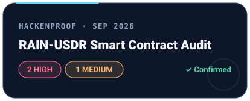</picture></a>
<a href="#security-research"><picture><source media="(prefers-color-scheme: dark)" srcset="assets/bento/audit-2-dark.svg"><source media="(prefers-color-scheme: light)" srcset="assets/bento/audit-2-light.svg">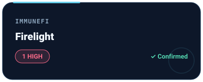</picture></a>
<a href="#security-research"><picture><source media="(prefers-color-scheme: dark)" srcset="assets/bento/audit-3-dark.svg"><source media="(prefers-color-scheme: light)" srcset="assets/bento/audit-3-light.svg">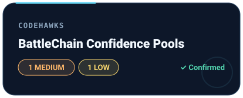</picture></a>
<a href="#security-research"><picture><source media="(prefers-color-scheme: dark)" srcset="assets/bento/record-dark.svg"><source media="(prefers-color-scheme: light)" srcset="assets/bento/record-light.svg">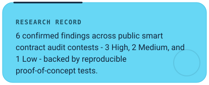</picture></a>

</div>

<picture><source media="(prefers-color-scheme: dark)" srcset="assets/bento/section-03-dark.svg"><source media="(prefers-color-scheme: light)" srcset="assets/bento/section-03-light.svg"></picture>

## Experience

<div align="center">

<a href="#experience"><picture><source media="(prefers-color-scheme: dark)" srcset="assets/bento/exp-1-dark.svg"><source media="(prefers-color-scheme: light)" srcset="assets/bento/exp-1-light.svg"></picture></a>
<a href="#experience"><picture><source media="(prefers-color-scheme: dark)" srcset="assets/bento/exp-2-dark.svg"><source media="(prefers-color-scheme: light)" srcset="assets/bento/exp-2-light.svg">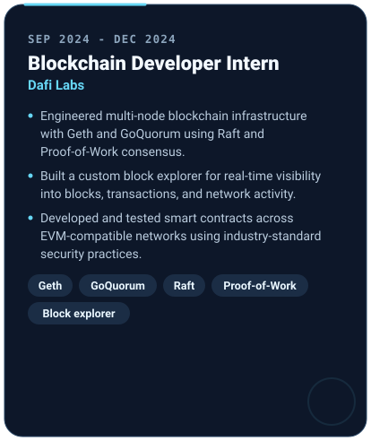</picture></a>

</div>

<picture><source media="(prefers-color-scheme: dark)" srcset="assets/bento/section-04-dark.svg"><source media="(prefers-color-scheme: light)" srcset="assets/bento/section-04-light.svg"></picture>

## Selected Engineering Work

<div align="center">

<a href="#selected-engineering-work"><picture><source media="(prefers-color-scheme: dark)" srcset="assets/bento/project-1-dark.svg"><source media="(prefers-color-scheme: light)" srcset="assets/bento/project-1-light.svg">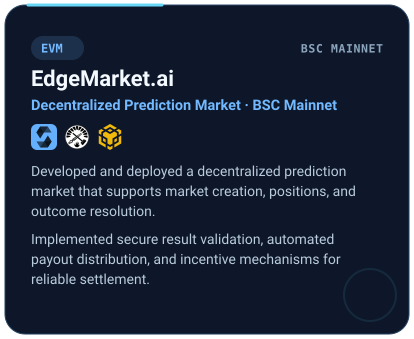</picture></a>
<a href="#selected-engineering-work"><picture><source media="(prefers-color-scheme: dark)" srcset="assets/bento/project-2-dark.svg"><source media="(prefers-color-scheme: light)" srcset="assets/bento/project-2-light.svg">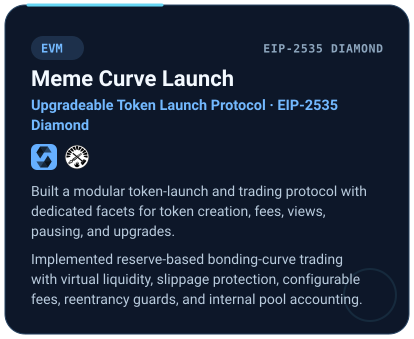</picture></a>
<a href="#selected-engineering-work"><picture><source media="(prefers-color-scheme: dark)" srcset="assets/bento/project-3-dark.svg"><source media="(prefers-color-scheme: light)" srcset="assets/bento/project-3-light.svg">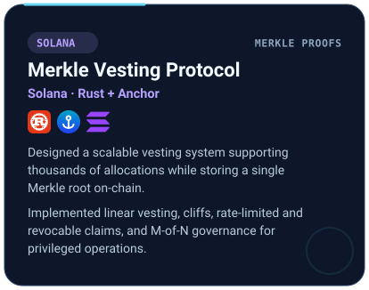</picture></a>
<a href="#selected-engineering-work"><picture><source media="(prefers-color-scheme: dark)" srcset="assets/bento/project-4-dark.svg"><source media="(prefers-color-scheme: light)" srcset="assets/bento/project-4-light.svg">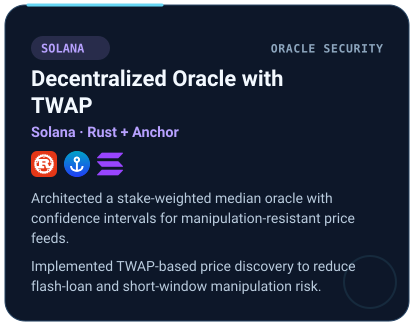</picture></a>
<a href="#selected-engineering-work"><picture><source media="(prefers-color-scheme: dark)" srcset="assets/bento/project-5-dark.svg"><source media="(prefers-color-scheme: light)" srcset="assets/bento/project-5-light.svg">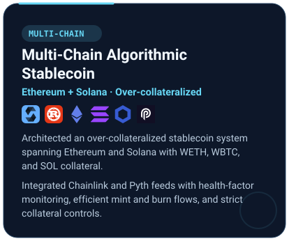</picture></a>
<a href="#selected-engineering-work"><picture><source media="(prefers-color-scheme: dark)" srcset="assets/bento/project-legend-dark.svg"><source media="(prefers-color-scheme: light)" srcset="assets/bento/project-legend-light.svg">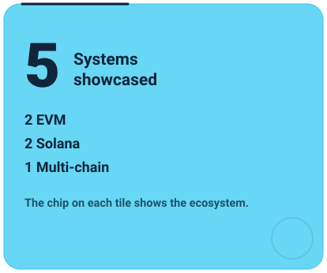</picture></a>

</div>

<picture><source media="(prefers-color-scheme: dark)" srcset="assets/bento/section-05-dark.svg"><source media="(prefers-color-scheme: light)" srcset="assets/bento/section-05-light.svg"></picture>

## Technical Toolkit

<div align="center">

<a href="#technical-toolkit"><picture><source media="(prefers-color-scheme: dark)" srcset="assets/bento/tool-1-dark.svg"><source media="(prefers-color-scheme: light)" srcset="assets/bento/tool-1-light.svg">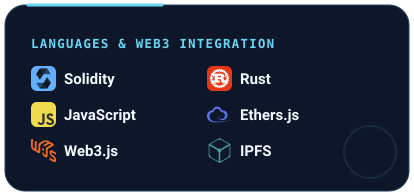</picture></a>
<a href="#technical-toolkit"><picture><source media="(prefers-color-scheme: dark)" srcset="assets/bento/tool-2-dark.svg"><source media="(prefers-color-scheme: light)" srcset="assets/bento/tool-2-light.svg">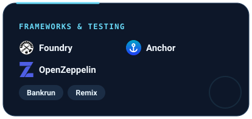</picture></a>
<a href="#technical-toolkit"><picture><source media="(prefers-color-scheme: dark)" srcset="assets/bento/tool-3-dark.svg"><source media="(prefers-color-scheme: light)" srcset="assets/bento/tool-3-light.svg">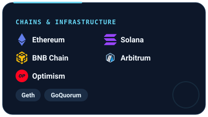</picture></a>
<a href="#technical-toolkit"><picture><source media="(prefers-color-scheme: dark)" srcset="assets/bento/tool-4-dark.svg"><source media="(prefers-color-scheme: light)" srcset="assets/bento/tool-4-light.svg">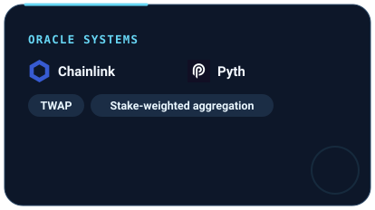</picture></a>
<a href="#technical-toolkit"><picture><source media="(prefers-color-scheme: dark)" srcset="assets/bento/tool-5-dark.svg"><source media="(prefers-color-scheme: light)" srcset="assets/bento/tool-5-light.svg">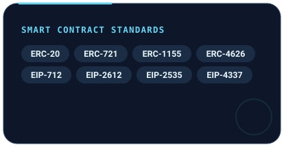</picture></a>
<a href="#technical-toolkit"><picture><source media="(prefers-color-scheme: dark)" srcset="assets/bento/tool-6-dark.svg"><source media="(prefers-color-scheme: light)" srcset="assets/bento/tool-6-light.svg">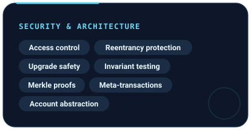</picture></a>

</div>

<picture><source media="(prefers-color-scheme: dark)" srcset="assets/bento/section-06-dark.svg"><source media="(prefers-color-scheme: light)" srcset="assets/bento/section-06-light.svg"></picture>

## Education & Continuous Learning

<div align="center">

<a href="#education--continuous-learning"><picture><source media="(prefers-color-scheme: dark)" srcset="assets/bento/edu-degree-dark.svg"><source media="(prefers-color-scheme: light)" srcset="assets/bento/edu-degree-light.svg"></picture></a>
<a href="#education--continuous-learning"><picture><source media="(prefers-color-scheme: dark)" srcset="assets/bento/edu-courses-dark.svg"><source media="(prefers-color-scheme: light)" srcset="assets/bento/edu-courses-light.svg">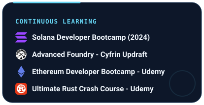</picture></a>

</div>

<picture><source media="(prefers-color-scheme: dark)" srcset="assets/bento/section-07-dark.svg"><source media="(prefers-color-scheme: light)" srcset="assets/bento/section-07-light.svg"></picture>

## What I Bring

<div align="center">

<a href="mailto:moinshahid919@gmail.com"><picture><source media="(prefers-color-scheme: dark)" srcset="assets/bento/bring-build-dark.svg"><source media="(prefers-color-scheme: light)" srcset="assets/bento/bring-build-light.svg">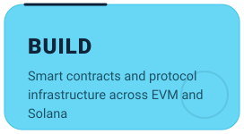</picture></a>
<a href="mailto:moinshahid919@gmail.com"><picture><source media="(prefers-color-scheme: dark)" srcset="assets/bento/bring-break-dark.svg"><source media="(prefers-color-scheme: light)" srcset="assets/bento/bring-break-light.svg">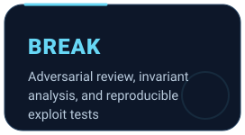</picture></a>
<a href="mailto:moinshahid919@gmail.com"><picture><source media="(prefers-color-scheme: dark)" srcset="assets/bento/bring-harden-dark.svg"><source media="(prefers-color-scheme: light)" srcset="assets/bento/bring-harden-light.svg">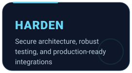</picture></a>

</div>

<div align="center">

### Let's build protocols that are difficult to break.

[](mailto:moinshahid919@gmail.com)
[](https://linkedin.com/in/moin-shahid)

</div>
